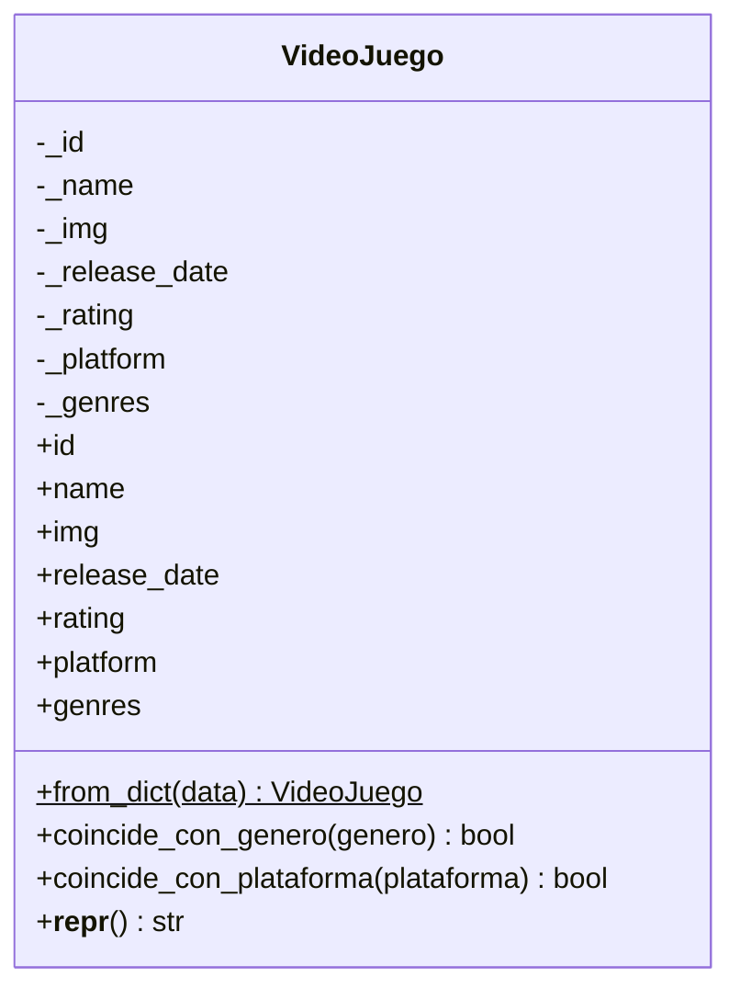

puede ser cambiado a esta extencion (o .png/.drawio)# Diagrama de clases

## Clase VideoJuego

La clase `VideoJuego`, ubicada en `modelos`, representa un videojuego del catálogo de NextPlay. Encapsula sus atributos y proporciona propiedades para consultarlos, además de métodos para comprobar coincidencias por género y plataforma.

### Dos detalles para tener en cuenta

- Los signos `-` representan atributos privados y `+` representa operaciones públicas en UML. El símbolo `$` indica que `from_dict()` es un método de clase.
- Las propiedades aparecen como operaciones de acceso en el diagrama porque permiten consultar los atributos desde otras partes del programa.
