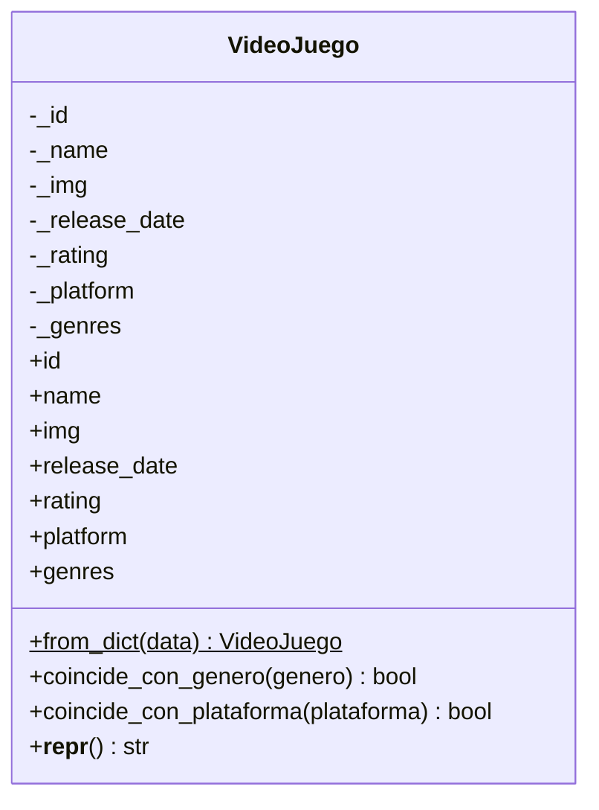
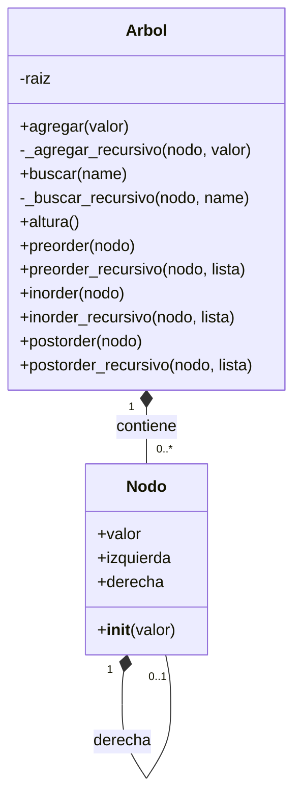
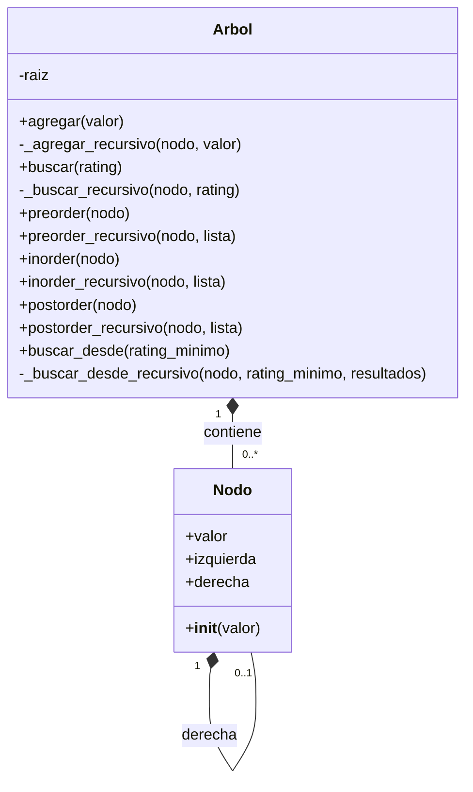
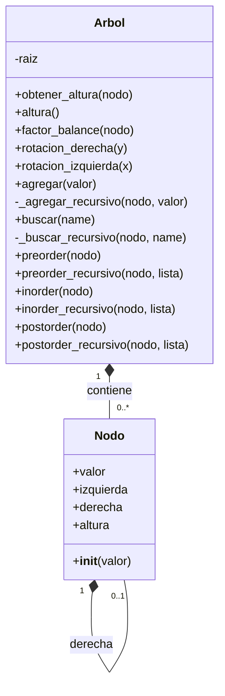
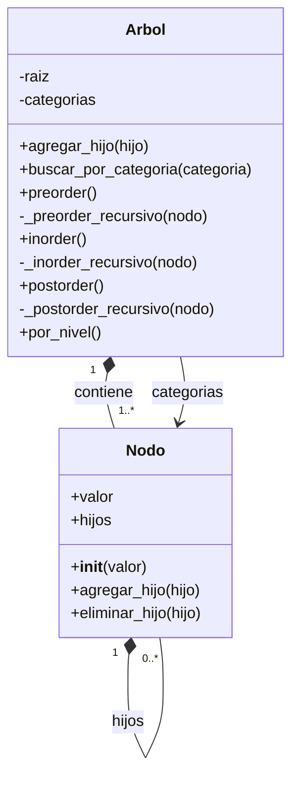
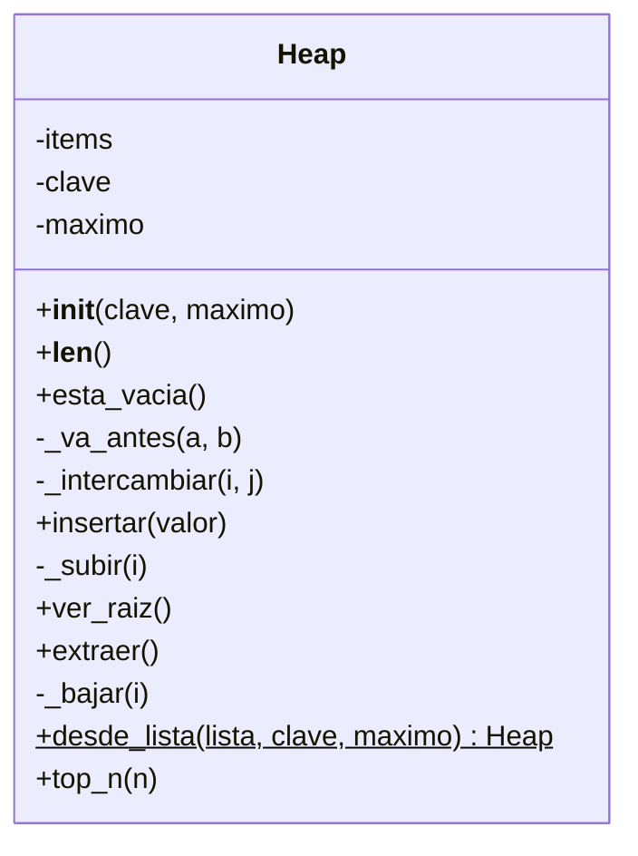
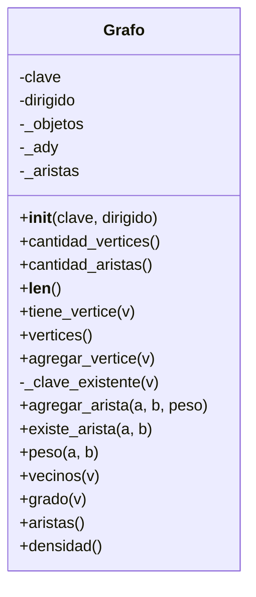

## Clase VideoJuego

La clase `VideoJuego`, ubicada en `modelos`, representa un videojuego del catálogo de NextPlay. Encapsula sus atributos y proporciona propiedades para consultarlos, además de métodos para comprobar coincidencias por género y plataforma.

### Dos detalles para tener en cuenta

- Los signos `-` representan atributos privados y `+` representa operaciones públicas en UML. El símbolo `$` indica que `from_dict()` es un método de clase.
- Las propiedades aparecen como operaciones de acceso en el diagrama porque permiten consultar los atributos desde otras partes del programa.

## Árbol binario de búsqueda por nombre

La clase `Arbol` implementa un árbol binario de búsqueda que permite organizar los videojuegos alfabéticamente según su nombre. Utiliza la clase `Nodo` para almacenar cada videojuego y establecer las conexiones con sus nodos izquierdo y derecho.

La inserción y búsqueda se realizan de forma recursiva, comparando los nombres sin distinguir entre mayúsculas y minúsculas. Además, permite calcular la altura del árbol y realizar tres tipos de recorridos: preorden, inorden y postorden. El recorrido inorden devuelve los videojuegos ordenados alfabéticamente.

### Algunas decisiones del diagrama

- `Arbol` tiene una `raiz` que apunta al primer `Nodo`.
- Cada `Nodo` almacena un videojuego en `valor` y puede tener dos nodos hijos: `izquierda` y `derecha`.
- Los métodos que empiezan con `_` aparecen como privados siguiendo la convención de Python.

## Árbol binario de búsqueda por rating

La clase `Arbol` implementa un árbol binario de búsqueda que organiza los videojuegos según su valoración (`rating`). Utiliza la clase `Nodo` para almacenar cada videojuego y establecer las conexiones con sus nodos izquierdo y derecho.

La inserción y búsqueda se realizan de forma recursiva, comparando las valoraciones de los videojuegos. Además, permite calcular los recorridos preorden, inorden y postorden.

También incorpora el método `buscar_desde()`, que permite obtener los videojuegos cuya valoración es mayor o igual a un valor mínimo indicado. Los resultados se devuelven ordenados de mayor a menor rating.

## Árbol AVL

La clase `Arbol` implementa un árbol binario de búsqueda balanceado (AVL) que organiza los videojuegos según su nombre. Utiliza la clase `Nodo` para almacenar cada videojuego y mantener las conexiones con sus nodos izquierdo y derecho.

A diferencia de un árbol binario de búsqueda convencional, el AVL mantiene el equilibrio de su estructura mediante el cálculo de alturas y factores de balance. Para ello, utiliza rotaciones simples y dobles que permiten conservar el balance después de cada inserción.

También permite buscar videojuegos por nombre y realizar recorridos preorden, inorden y postorden.

### Algunas aclaraciones

- `altura` en `Nodo` almacena la altura de cada nodo y comienza con valor `1`.
- `factor_balance()` calcula la diferencia entre las alturas de los subárboles izquierdo y derecho.
- `rotacion_derecha()` y `rotacion_izquierda()` realizan los ajustes necesarios para mantener el equilibrio.
- `_agregar_recursivo()` inserta los videojuegos y realiza las rotaciones cuando son necesarias.
## Árbol general

La clase `Arbol` implementa un árbol general que permite organizar los videojuegos según diferentes categorías, como géneros y plataformas. Utiliza la clase `Nodo`, que puede contener una cantidad variable de nodos hijos.

Cada árbol tiene una raíz que identifica el criterio de organización. Además, utiliza un diccionario auxiliar llamado `categorias` para acceder directamente a los nodos correspondientes a cada categoría, evitando recorrer constantemente los hijos de la raíz.

Permite agregar videojuegos, buscar por categoría y realizar distintos tipos de recorridos: preorden, inorden, postorden y por nivel. Para el recorrido por nivel utiliza una cola FIFO implementada mediante `deque`.

### Algunas aclaraciones

- `raiz` representa el nodo principal del árbol y contiene el criterio de organización (`genres` o `platform`).
- `categorias` es un diccionario que relaciona cada categoría con su nodo correspondiente.
- `hijos` permite que cada nodo tenga cero o más descendientes, a diferencia de los árboles binarios.
- `buscar_por_categoria()` devuelve los nodos que contienen los videojuegos de la categoría solicitada.
- `por_nivel()` utiliza `deque` para recorrer los nodos de izquierda a derecha por niveles.

## Clase Heap

La clase `Heap` implementa una estructura de datos de tipo Heap binario, utilizada para organizar videojuegos según un criterio de prioridad, como su valoración (`rating`). Se implementa manualmente sobre una lista, sin utilizar bibliotecas externas.

La estructura representa un árbol binario completo, donde cada elemento se relaciona con sus hijos mediante índices de la lista. Permite configurar un Heap de máximos, donde la raíz contiene la prioridad más alta, o un Heap de mínimos, donde contiene la prioridad más baja.

Entre sus operaciones principales se encuentran la inserción de elementos, la consulta y extracción de la raíz, y la construcción de un Heap a partir de una lista existente. También incorpora el método `top_n()`, que permite obtener los primeros N elementos del ranking sin modificar el Heap original.

### Algunas aclaraciones
- `items` almacena los elementos del Heap en una lista.
- `clave` es una función que determina la prioridad de cada elemento.
- `maximo` indica si se utiliza un Heap de máximos o de mínimos.
- `_subir()` y `_bajar()` mantienen la propiedad de prioridad del Heap después de las operaciones.
- `desde_lista()` es un método de clase que construye un Heap a partir de una lista.
- `top_n()` obtiene los primeros N elementos del ranking sin modificar la estructura original.

## Clase Grafo

La clase `Grafo` implementa un grafo pesado mediante una lista de adyacencia, utilizando diccionarios para almacenar los vértices y sus conexiones. Cada vértice se identifica mediante una clave y mantiene un diccionario con sus vecinos y el peso de las aristas correspondientes.

Permite trabajar con grafos dirigidos y no dirigidos. Por defecto, el grafo es no dirigido y cada arista tiene un peso inicial de 1.

La clase permite agregar vértices y aristas, consultar la existencia de conexiones, obtener los vecinos de un vértice y consultar el peso de las aristas. También proporciona operaciones para conocer la cantidad de vértices y aristas, calcular el grado de un vértice y determinar la densidad del grafo.

Los vértices pueden ser objetos de cualquier tipo, como `VideoJuego`, y se identifican mediante una función `clave` que permite establecer cómo se reconoce cada objeto.

### Algunas aclaraciones

- `_objetos` almacena los objetos originales asociados a sus respectivas claves.
- `_ady` contiene la lista de adyacencia: cada vértice tiene un diccionario con sus vecinos y los pesos de las conexiones.
- `_aristas` almacena la cantidad total de aristas del grafo.
- `clave` es una función que permite identificar los vértices. Para los videojuegos se puede utilizar su identificador (`id`).
- `dirigido` determina si las conexiones tienen un único sentido o si se establecen en ambos sentidos.
- `agregar_arista()` permite conectar dos vértices y asignar un peso a la conexión.
- `vecinos()` devuelve los vértices conectados y sus respectivos pesos.
- `densidad()` calcula la proporción de aristas existentes respecto de las posibles.

### Complejidad espacial

El grafo utiliza listas de adyacencia implementadas con diccionarios, por lo que su complejidad espacial es **O(V + E)**, donde V representa la cantidad de vértices y E la cantidad de aristas. Esto permite utilizar menos memoria que una matriz de adyacencia cuando el grafo tiene pocas conexiones.