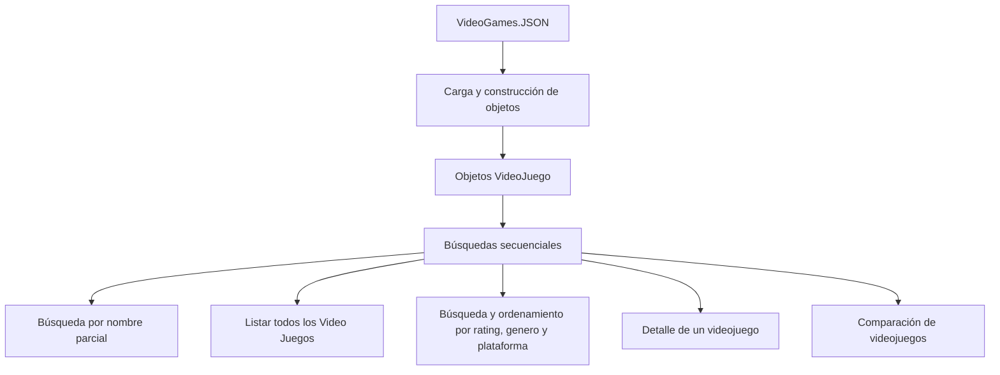
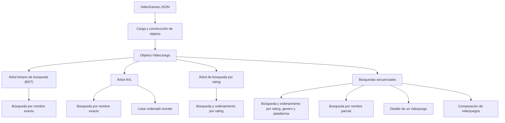
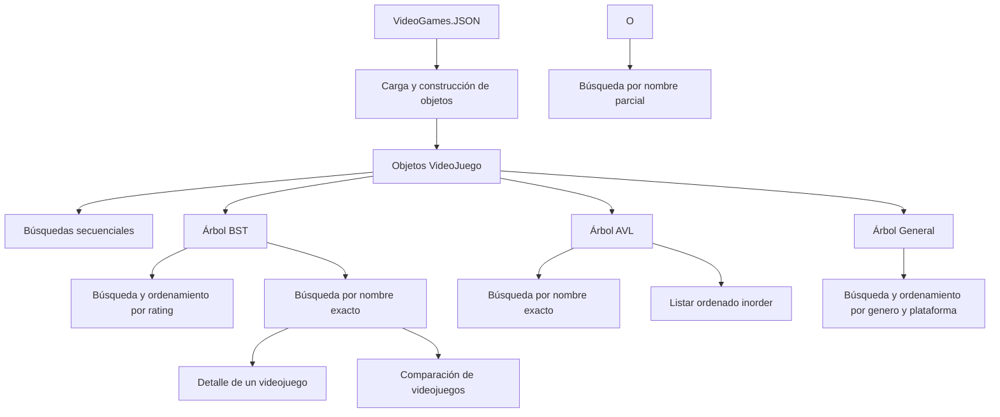
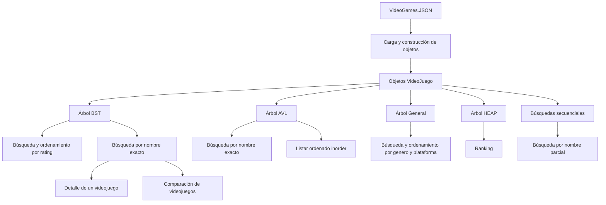

# Diagrama de datos

## Organización de los datos

NextPlay obtiene los datos de los videojuegos desde el archivo `VideoGames.JSON`. A partir de esos registros se construyen objetos de la clase `VideoJuego`, que contienen información como el nombre, el rating, las plataformas y los géneros.

Los objetos se utilizan para construir diferentes estructuras de datos y realizar búsquedas y consultas sobre el catálogo.

## Estructuras y conexiones
## version 1

## Descripción de las estructuras

- **VideoGames.JSON:** archivo que contiene los datos del catálogo de videojuegos.
- **VideoJuego:** clase que representa cada videojuego y sus atributos.
- **Búsquedas secuenciales:** recorren los videojuegos para encontrar los datos necesarios para operaciones como consultar el detalle o comparar videojuegos.

## version 2

## Descripción de las estructuras

- **VideoGames.JSON:** archivo que contiene los datos del catálogo de videojuegos.
- **VideoJuego:** clase que representa cada videojuego y sus atributos.
- **Árbol binario de búsqueda (BST):** organiza los videojuegos por nombre y permite realizar búsquedas por nombre exacto.
- **Árbol AVL:** árbol de búsqueda balanceado por nombre que mantiene su altura controlada durante las inserciones organiza los videojuegos por nombre y permite realizar búsquedas por nombre exacto, tambien ordena inorder para listar todos los videojuegos.
- **Árbol de búsqueda por rating:** organiza los videojuegos según su puntuación para facilitar las consultas y el ordenamiento por rating.
- **Búsquedas secuenciales:** recorren los videojuegos para encontrar los datos necesarios para operaciones como consultar el detalle o comparar videojuegos.

Las estructuras utilizan objetos `VideoJuego` como elementos de información. Cada árbol mantiene su propia organización según el criterio de búsqueda correspondiente, mientras que las búsquedas secuenciales recorren los elementos del catálogo según la operación que se necesita realizar.

## version 3

## Descripción de las estructuras

- **VideoGames.JSON:** archivo que contiene los datos del catálogo de videojuegos.
- **VideoJuego:** clase que representa cada videojuego y sus atributos.
- **Árbol binario de búsqueda (BST):** organiza los videojuegos por nombre y permite realizar búsquedas por nombre exacto, se utiliza para buscar el detalle y para comparar dos videojuegos.
- **Árbol (AVL):** árbol de búsqueda balanceado por nombre que mantiene su altura controlada durante las inserciones organiza los videojuegos por nombre y permite realizar búsquedas por nombre exacto, tambien ordena inorder para listar todos los videojuegos.
- **Árbol de búsqueda por rating (BST):** organiza los videojuegos según su puntuación para facilitar las consultas y el ordenamiento por rating.
- **Árbol General:** organiza los videojuegos por categorias, generos o plataformas.

## version 4

## Descripción de las estructuras

- **VideoGames.JSON:** archivo que contiene los datos del catálogo de videojuegos.
- **VideoJuego:** clase que representa cada videojuego y sus atributos.
- **Árbol binario de búsqueda (BST):** organiza los videojuegos por nombre y permite realizar búsquedas por nombre exacto, se utiliza para buscar el detalle y para comparar dos videojuegos.
- **Árbol (AVL):** árbol de búsqueda balanceado por nombre que mantiene su altura controlada durante las inserciones organiza los videojuegos por nombre y permite realizar búsquedas por nombre exacto, tambien ordena inorder para listar todos los videojuegos.
- **Árbol de búsqueda por rating (BST):** organiza los videojuegos según su puntuación para facilitar las consultas y el ordenamiento por rating.
- **Árbol General:** organiza los videojuegos por categorias, generos o plataformas.
- **Árbol HEAP:** Crea un ranking de todos los videojuegos por rating.
